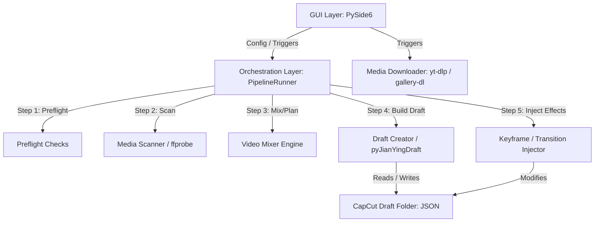

# PROJECT MAP: CapCut Long Story Studio

This document maps the entire CapCut Long Story Studio project, including its overview, architectural design, core modules, directory structure, dependencies, and primary data flows.

---

## 1. Overview

CapCut Long Story Studio is a specialized desktop application built with PySide6 designed to automate the process of creating long-form storytelling videos (video kể chuyện dài) in CapCut PC. 

Rather than rendering the final video (which is resource-intensive), this tool directly generates or modifies CapCut project draft directories. It parses audio voice tracks, subtitle files (SRT), background media assets, logos, and overlays, and synthesizes them into a draft timeline layout. The user can then open this timeline directly in the official CapCut PC application for final review and rendering.

---

## 2. Architecture

The application is built on a modular, layer-oriented desktop architecture:



### Architectural Tiers:
1.  **Presentation Tier (GUI)**: Built with PySide6, running asynchronous worker threads to prevent window freezing during heavy tasks.
2.  **Orchestration Tier (Pipeline)**: Executes the sequential steps of draft generation, handling logs, cancellation events, and step callbacks.
3.  **Domain Logic Tier (Engine & Services)**: Handles background media scanning, video/audio mixing algorithms, asset downloader pools, and draft recovery tools.
4.  **Data Access Tier (pyJianYingDraft Wrapper)**: Directly writes and manipulates CapCut's proprietary project JSON files.

---

## 3. Main Modules

*   **[main.py](file:///D:/1.%20LapTrinh/capcut%20tool/main.py)**: Application entry point. Sets up high-DPI scaling policies and default application fonts.
*   **[runtime_tools.py](file:///D:/1.%20LapTrinh/capcut%20tool/runtime_tools.py)**: Dynamically resolves portable binaries (`ffmpeg`, `ffprobe`, `yt-dlp`, `gallery-dl`) and prepends their directories to the process `PATH`.
*   **[media_probe.py](file:///D:/1.%20LapTrinh/capcut%20tool/media_probe.py)**: Spawns `ffprobe` subprocesses to read media dimensions, frame rates, and durations.
*   **[video_mixer.py](file:///D:/1.%20LapTrinh/capcut%20tool/video_mixer.py)**: Implements visual timeline placement logic, planning cuts and durations to match subtitle or voice timings.
*   **[capcut_draft_creator.py](file:///D:/1.%20LapTrinh/capcut%20tool/capcut_draft_creator.py)**: Integrates voiceovers, SRT lines, overlays, and background tracks into a physical CapCut draft folder.
*   **[capcut_keyframe_tool.py](file:///D:/1.%20LapTrinh/capcut%20tool/capcut_keyframe_tool.py)**: Directly edits JSON fields to apply transitions and keyframe movements.
*   **[draft_doctor.py](file:///D:/1.%20LapTrinh/capcut%20tool/draft_doctor.py)**: Performs checks and fixes corrupted draft paths, missing properties, or invalid FPS metadata.
*   **[app/gui.py](file:///D:/1.%20LapTrinh/capcut%20tool/app/gui.py)**: Monolithic UI layout script, settings manager, and thread runner.
*   **[app/pipeline.py](file:///D:/1.%20LapTrinh/capcut%20tool/app/pipeline.py)**: Orchestrates the pipeline pipeline flow.
*   **[app/downloader.py](file:///D:/1.%20LapTrinh/capcut%20tool/app/downloader.py)**: Executes concurrent download processes.
*   **[app/path_validation.py](file:///D:/1.%20LapTrinh/capcut%20tool/app/path_validation.py)**: Validates project directories to prevent path traversal.
*   **[app/draft_lock.py](file:///D:/1.%20LapTrinh/capcut%20tool/app/draft_lock.py)**: Implements reentrant file locking to avoid writes while CapCut is running.
*   **[app/draft_cleanup.py](file:///D:/1.%20LapTrinh/capcut%20tool/app/draft_cleanup.py)**: Cleans up old backup directories and partial/aborted folders.
*   **[pyJianYingDraft/](file:///D:/1.%20LapTrinh/capcut%20tool/pyJianYingDraft)**: Low-level library that maps timelines, audio, video, transitions, and text into JSON segments.

---

## 4. File Structure

```
capcut tool/
│
├── app/                      # UI, pipeline, and worker service modules
│   ├── downloader.py         # yt-dlp & gallery-dl download orchestration
│   ├── draft_cleanup.py      # Cleans backup files and partial drafts
│   ├── draft_lock.py         # Multi-process folder locks
│   ├── gui.py                # Main PySide6 UI window
│   ├── history.py            # Download and execution logs history
│   ├── job_control.py        # Thread interruption signals
│   ├── path_validation.py    # Path traversal validation library
│   ├── pipeline.py           # Multi-step execution orchestrator
│   ├── preflight.py          # Sanity checks on paths and tools
│   └── presets.py            # Keyframe and transition presets
│
├── docs/                     # Documentation folder
├── pyJianYingDraft/          # Low-level CapCut timeline wrapper package
├── scripts/                  # Code obfuscation and compilation scripts
├── tests/                    # Pipeline and feature unit tests
├── tools/                    # Bundled portable third-party binaries
│
├── capcut_draft_creator.py   # Synthesizes inputs into a draft
├── capcut_keyframe_tool.py   # Injects keyframe and transition codes
├── draft_doctor.py           # Self-healing diagnostic library
├── main.py                   # PySide6 application startup
├── media_probe.py            # Media metadata extraction tool
└── video_mixer.py            # Background clip mixing engine
```

---

## 5. Dependencies

The application relies on external Python modules (specified in [requirements.txt](file:///D:/1.%20LapTrinh/capcut%20tool/requirements.txt)) and bundled tools under the `tools/` folder:

1.  **PySide6 (`>=6.11.1`)**: GUI framework and asynchronous worker signals.
2.  **yt-dlp (`>=2025.1.15`) & gallery-dl (`>=1.27.0`)**: Spawned in background threads for media asset downloading.
3.  **imageio (`>=2.33.0`) & imageio-ffmpeg (`>=0.6.0`)**: Used exclusively for retrieving GIF durations and as an FFMpeg resolver fallback.
4.  **pillow (`>=10.0.0`)**: Listed in requirements, but **never imported** (identified as dead package dependency).
5.  **pymediainfo (`>=7.0.1`)**: Used as a fallback in [media_probe.py](file:///D:/1.%20LapTrinh/capcut%20tool/media_probe.py) when `ffprobe` is missing.
6.  **FFmpeg & FFprobe (bundled)**: Located under `tools/ffmpeg/bin/`. Essential for chroma-key overlay conversion, video splitting, and metadata scanning.

---

## 6. Data Flow

### A. Downloader Data Flow
```
User inputs URLs (GUI) 
   ──> parse_url_list() (app/downloader.py) 
   ──> _validate_url() (URL Safety Checks) 
   ──> resolve_ytdlp_command() (Resolves paths) 
   ──> Spawns yt-dlp/gallery-dl subprocesses 
   ──> Downloads media assets to media_dir 
   ──> Updates Job History (app/history.py)
```

### B. CapCut Draft Generation Data Flow
```
User clicks "Tạo dự án" (GUI)
   ──> Run PipelineRunner (app/pipeline.py)
   ──> Step 1: run_preflight() (app/preflight.py - Checks space & binaries)
   ──> Step 2: scan_media_folder() (media_probe.py - Runs ffprobe on assets)
   ──> Step 3: plan_media() (video_mixer.py - Maps clips to speech durations)
   ──> Step 4: write_draft() (capcut_draft_creator.py - Assembles segments using pyJianYingDraft)
   ──> Step 5: apply_effects() (capcut_keyframe_tool.py - Modifies JSON for keyframes/transitions)
   ──> Result: Completed project in CapCut com.lveditor.draft directory
```
