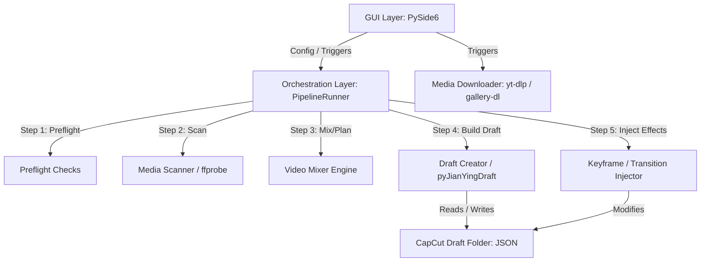

# PROJECT MAP: CapCut Long Story Studio

This document maps the entire CapCut Long Story Studio project, including its overview, architectural design, core modules, directory structure, dependencies, and primary data flows.

---

## 1. Overview

CapCut Long Story Studio is a specialized desktop application built with PySide6 designed to automate the process of creating long-form storytelling videos (video kể chuyện dài) in CapCut PC. 

Rather than rendering the final video (which is resource-intensive), this tool directly generates or modifies CapCut project draft directories. It parses audio voice tracks, subtitle files (SRT), background media assets, logos, and overlays, and synthesizes them into a draft timeline layout. The user can then open this timeline directly in the official CapCut PC application for final review and rendering.

---

## 2. Architecture

The application is built on a modular, layer-oriented desktop architecture:



### Architectural Tiers:
1.  **Presentation Tier (GUI)** — `app/gui.py`, `app/widgets/`, `app/controllers/`: PySide6, with worker threads so the window does not freeze during heavy tasks.
2.  **Orchestration Tier** — `app/pipeline.py`, `app/queue_manager.py`, `app/preflight.py`: sequential draft-generation steps, logs, cancellation, step callbacks, and the batch build queue.
3.  **Domain Logic Tier** — `core/`, `media_probe.py`, `video_mixer.py`, `profiles/`, `assets/`: media scanning, clip allocation, chroma-key, downloads, presets. Independent of the UI, with one exception noted in `CODE_AUDIT.md` §6C.
4.  **Draft-Writing Tier** — `pyJianYingDraft/`, `capcut_draft_creator.py`, `capcut_keyframe_tool.py`, `draft_doctor.py`: writes and repairs CapCut's project JSON.

A release-hardening layer (`mvp_runtime/`) wraps startup: single-instance lock, rotating logs, crash reports, and the `--diagnose` checks.

---

## 3. Main Modules

Line counts are as of 2026-08-07 and are indicative, not exact.

### Entry point & runtime

*   **`main.py`** (14): Thin entry point. Inserts the project root on `sys.path` and delegates to `mvp_runtime.bootstrap.run_app`.
*   **`mvp_runtime/`** (398): Release-hardening layer. `bootstrap.py` handles the `--version` / `--diagnose` / `--diagnose-json` flags, single-instance locking via `QLockFile`, and app metadata. `logging_setup.py` provides rotating logs and crash reports; `app_paths.py` resolves the user app-data directory; `diagnostics.py` runs the environment checks.
*   **`runtime_tools.py`** (207): Resolves portable binaries (`ffmpeg`, `ffprobe`, `yt-dlp`, `gallery-dl`) and prepends their directories to the process `PATH`.

### Presentation tier

*   **`app/gui.py`** (2,244): Main window, settings persistence, worker-thread wiring. Still large, but the per-tab UI now lives in `app/widgets/`.
*   **`app/widgets/`** (6,855): One module per tab or panel — `setup_widget.py` (1,569), `media_studio_widget.py` (1,493), `history_widget.py` (1,089), `effects_widget.py` (909), `build_widget.py` (885), `dashboard_widget.py` (734), plus `toast.py` for transient notifications.
*   **`app/controllers/profile_controller.py`** (517): Mediates between the profile UI and `profiles/manager.py`.
*   **`app/theme.py`** (556) and **`app/icons.py`**: Stylesheet tokens and icon set.
*   **`app/workers.py`** (396): `QThread` worker classes; honour cancellation via `requestInterruption`.

### Orchestration tier

*   **`app/pipeline.py`** (445): `PipelineRunner` — runs preflight → scan → plan → write draft, emitting step results and log lines.
*   **`app/queue_manager.py`** (662): `BatchQueueManager` — batch build queue persisted in SQLite, with pause/cancel and child-process termination. Its mutex must stay recursive; see `CODE_AUDIT.md` §7.
*   **`app/preflight.py`** (337): Input and environment checks before a run.
*   **`app/job_control.py`**, **`app/history.py`**: Cancellation signalling and job history records.

### Domain logic tier

*   **`core/downloader/downloader.py`** (911): The real downloader — yt-dlp and gallery-dl orchestration, URL validation, progress parsing. `app/downloader.py` is only a 31-line re-export shim.
*   **`core/media.py`** (292): Media helpers used by the media studio.
*   **`core/db.py`** (246): SQLite layer backing the profile, asset and build-queue features. Imported at startup.
*   **`core/chroma.py`** (151): Chroma-key removal for logo/overlay assets, via Pillow for images and FFmpeg for video.
*   **`core/cutter/cutter.py`** (123): Clip cutting.
*   **`core/path_validation.py`** (118): Validates project names and draft paths against traversal. Stdlib-only, no dependency on `app`.
*   **`core/logger.py`** (67), **`core/effects.py`** (24): Shared logger and effect definitions.
*   **`media_probe.py`** (516): `ffprobe` metadata reads with a bounded cache, in-flight sharing between threads, and a `pymediainfo` fallback. Concurrent via `ThreadPoolExecutor`.
*   **`video_mixer.py`** (447): Plans which background clip covers which span of the voice track.
*   **`profiles/manager.py`** (356) and **`profiles/subtitle.py`** (119): Preset profiles with versioning, cloning and import/export.
*   **`assets/manager.py`** (250): Asset library index.

### Draft-writing tier

*   **`capcut_draft_creator.py`** (892): Assembles voice, SRT, overlays and background tracks into a CapCut draft folder.
*   **`capcut_keyframe_tool.py`** (951): Edits draft JSON to apply keyframes, transitions, speed and scale.
*   **`draft_doctor.py`** (761): Diagnoses and repairs broken media paths, missing properties and bad FPS metadata.
*   **`app/draft_lock.py`**: Reentrant folder locking so two writers cannot touch one draft.
*   **`app/draft_cleanup.py`**: Removes stale backups and aborted partial folders.
*   **`pyJianYingDraft/`** (20,184, vendored): Maps timelines, audio, video, transitions and text into CapCut's JSON segments. Apache-2.0 — see `NOTICE`.

---

## 4. File Structure

```
capcut tool/
│
├── app/                      # Presentation + orchestration
│   ├── widgets/              # One module per tab/panel (~6,900 LOC)
│   │   ├── setup_widget.py       # Tab 1: inputs and presets
│   │   ├── media_studio_widget.py# Media studio
│   │   ├── history_widget.py     # Job history table
│   │   ├── effects_widget.py     # Tab 2: keyframe & transition editor
│   │   ├── build_widget.py       # Build queue UI
│   │   ├── dashboard_widget.py   # Dashboard
│   │   └── toast.py              # Transient notifications
│   ├── controllers/
│   │   └── profile_controller.py # Profile UI <-> profiles/manager
│   ├── gui.py                # Main window, settings, worker wiring
│   ├── pipeline.py           # PipelineRunner: preflight -> ... -> write
│   ├── queue_manager.py      # BatchQueueManager, SQLite-backed queue
│   ├── workers.py            # QThread workers
│   ├── preflight.py          # Input/environment checks
│   ├── theme.py, icons.py    # Styling
│   ├── downloader.py         # 31-line shim -> core/downloader
│   ├── draft_lock.py         # Multi-process folder locks
│   ├── draft_cleanup.py      # Cleans backups and partial drafts
│   ├── history.py            # Job history records
│   ├── job_control.py        # Cancellation signalling
│   └── presets.py            # Keyframe and transition presets
│
├── core/                     # Domain logic, no UI dependency
│   ├── downloader/
│   │   └── downloader.py     # Real downloader (911 LOC)
│   ├── cutter/cutter.py      # Clip cutting
│   ├── media.py              # Media helpers
│   ├── db.py                 # SQLite layer (imported at startup)
│   ├── chroma.py             # Chroma-key via Pillow + FFmpeg
│   ├── path_validation.py    # Path traversal validation (stdlib only)
│   ├── logger.py             # Shared logger
│   └── effects.py            # Effect definitions
│
├── mvp_runtime/              # Release hardening
│   ├── bootstrap.py          # CLI flags, single-instance lock
│   ├── diagnostics.py        # --diagnose checks
│   ├── logging_setup.py      # Rotating logs, crash reports
│   └── app_paths.py          # User app-data paths
│
├── profiles/                 # Preset profiles (versioning, import/export)
├── assets/                   # Asset library index
├── pyJianYingDraft/          # Vendored CapCut JSON library (Apache-2.0)
├── docs/                     # Documentation
├── tests/                    # 98 tests
├── tools/                    # Bundled portable binaries (FFmpeg: GPL v3)
├── scripts/                  # Legacy build + obfuscation scripts
│
├── src/, src-tauri/          # EXPERIMENTAL Tauri/Rust branch, not shipped
│                             # -> see PROJECT.md
│
├── capcut_draft_creator.py   # Assembles inputs into a draft
├── capcut_keyframe_tool.py   # Injects keyframes and transitions
├── draft_doctor.py           # Draft diagnostics and repair
├── media_probe.py            # ffprobe metadata, cached and concurrent
├── video_mixer.py            # Background clip allocation
├── runtime_tools.py          # Portable binary resolution
├── main.py                   # Entry point -> mvp_runtime.bootstrap
├── capcut_mvp.spec           # PyInstaller spec (release path)
├── build_mvp.ps1             # Release build script
├── README.md                 # Project readme
└── NOTICE                    # Third-party attributions
```

---

## 5. Dependencies

The application relies on external Python modules (specified in [requirements.txt](file:///D:/1.%20LapTrinh/capcut%20tool/requirements.txt)) and bundled tools under the `tools/` folder:

1.  **PySide6 (`>=6.11.1`)**: GUI framework and asynchronous worker signals.
2.  **yt-dlp (`>=2025.1.15`) & gallery-dl (`>=1.27.0`)**: Spawned in background threads for media asset downloading.
3.  **imageio (`>=2.33.0`) & imageio-ffmpeg (`>=0.6.0`)**: Used exclusively for retrieving GIF durations and as an FFMpeg resolver fallback.
4.  **pillow (`>=10.0.0`)**: Used by `core/chroma.py` to remove solid-color backgrounds from logo/overlay images. *(Corrected 2026-08-07: this entry previously claimed pillow was never imported. It was in fact used but missing from `requirements.txt`; the dependency has been added.)*
5.  **pymediainfo (`>=7.0.1`)**: Used as a fallback in [media_probe.py](file:///D:/1.%20LapTrinh/capcut%20tool/media_probe.py) when `ffprobe` is missing.
6.  **FFmpeg & FFprobe (bundled)**: Located under `tools/ffmpeg/bin/`. Essential for chroma-key overlay conversion, video splitting, and metadata scanning.

---

## 6. Data Flow

### A. Downloader Data Flow
```
User inputs URLs (GUI)
   ──> parse_url_list()          (core/downloader/downloader.py)
   ──> _validate_url()           (http/https only; rejects ; | ` $ and control chars)
   ──> resolve_ytdlp_command()   (portable exe, else python -m yt_dlp)
   ──> build_ytdlp_command() / build_gallerydl_command()   (argv list, never a shell string)
   ──> Popen spawns yt-dlp / gallery-dl
   ──> Downloads media assets to media_dir
   ──> Updates Job History       (app/history.py)
```
*Note: `app/downloader.py` re-exports these symbols but holds no logic.*

### B. CapCut Draft Generation Data Flow
```
User clicks "Tạo dự án" (GUI)
   ──> Run PipelineRunner (app/pipeline.py)
   ──> Step 1: run_preflight() (app/preflight.py - Checks space & binaries)
   ──> Step 2: scan_media_folder() (media_probe.py - Runs ffprobe on assets)
   ──> Step 3: plan_media() (video_mixer.py - Maps clips to speech durations)
   ──> Step 4: write_draft() (capcut_draft_creator.py - Assembles segments using pyJianYingDraft)
   ──> Step 5: apply_effects() (capcut_keyframe_tool.py - Modifies JSON for keyframes/transitions)
   ──> Result: Completed project in CapCut com.lveditor.draft directory
```
